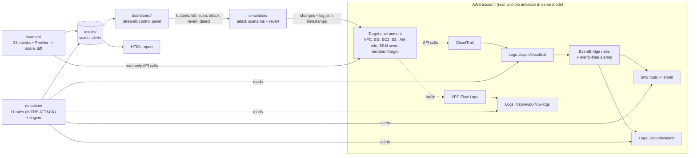

# Continuous Security Posture Assessment and Threat Detection for AWS

Runtime security for live AWS infrastructure: what happens **after** deployment, when
someone changes things by hand or an attacker uses stolen credentials. The system
**assesses, detects, alerts and reports**. There is **no auto-remediation**.

> **Demo mode.** The project's AWS account is blocked by an AWS Organizations service
> control policy (EC2, CloudTrail, SNS, EventBridge and more are denied). The lab therefore
> runs on [moto](https://github.com/getmoto/moto), a local AWS emulator. The **same
> Terraform and Python code** runs against real AWS with `CSPM_MODE=live`. In demo mode,
> CloudTrail and flow-log records are generated by the simulator and clearly marked. See
> [docs/emulator.md](docs/emulator.md) for exactly what is real and what is emulated.

## Architecture



| Module | Folder | What it does |
|---|---|---|
| 1 Target environment | `terraform/target/` | Small secure-by-default "company" environment, free tier |
| 2 Monitoring | `terraform/monitoring/` | CloudTrail, flow logs, log groups (14 days), SNS email, $1 budget, optional GuardDuty/Security Hub |
| 3 Posture scanner | `scanner/` | 24 checks (S3, SG, EC2, KMS/secrets, IAM, services) + Prowler, posture score, drift `diff` |
| 4 Threat detection | `detection/` + `terraform/monitoring/detections.tf` | 11 rule files mapped to MITRE ATT&CK, deployed as EventBridge rules/alarms, plus a Python engine |
| 5 Attack simulation | `simulation/` | 9 scenarios, each with `revert`; timestamps in `simulation/log.json` for MTTD |
| 6 Dashboard and report | `dashboard/`, `scanner/report.py` | Streamlit control panel + views; self-contained HTML assessment report |
| Lab controller | `lab/` | `python -m lab up` starts the emulator and deploys both Terraform stacks into it |

## Setup (Windows, macOS or Linux)

Needs Python 3.11+ and Terraform 1.6+.

```bash
git clone https://github.com/saswat017/aws-cspm-threat-detection
cd aws-cspm-threat-detection
python -m venv .venv
```
Activate it: `.venv\Scripts\activate` (Windows PowerShell) or `source .venv/bin/activate`.
```bash
pip install -r requirements.txt
copy .env.example .env        # Windows (cp on macOS/Linux); default CSPM_MODE=demo
python -m pytest -q           # 30 unit tests, no AWS needed
```

## Demo script (about 5 minutes)

```bash
python -m lab up                      # 1. start emulator + deploy 68 resources (~2 min)
python -m scanner scan                # 2. baseline posture score
python -m detection watch             # 3. in a SECOND terminal: live detection every 10 s
python -m simulation run all          # 4. attack: open SSH, public bucket, rogue admin, ...
                                      #    -> alerts appear in the watch terminal
python -m scanner scan                # 5. score drops
python -m scanner diff                # 6. drift: NEW findings
python -m simulation mttd             # 7. mean time to detect per attack
python -m simulation revert all       # 8. manual cleanup
python -m scanner scan                # 9. score back up
python -m scanner diff                # 10. drift: RESOLVED findings
python -m scanner report              # 11. HTML assessment report in results/
python -m lab down                    # stop the emulator
```

Or do the whole demo by clicking in the dashboard (below).

Expected: 12/12 expected detections fire; score about 85 -> 72 -> 85.
`make <target>` (Linux/macOS) and `.\make.ps1 <target>` (Windows) wrap the same commands.

## Dashboard

```bash
python -m streamlit run dashboard/app.py      # opens http://localhost:8501
```

Everything in the demo script can be done from the dashboard:

- **Sidebar controls:** start/stop the lab, run a posture scan, check for threats now,
  **live detection** (re-checks every 10 s and pops up a notification per alert), generate
  and download the HTML report.
- **Overview:** posture score and change, score per scan, failed findings by severity,
  service and CIS section.
- **Findings:** filterable table with evidence and recommendations.
- **Drift:** new and resolved findings between the last two scans.
- **Threat detection:** alert feed (MITRE technique, actor, source IP), alerts per rule,
  the rule-to-MITRE mapping.
- **Attack simulation:** Run / Revert buttons per scenario, mean time to detect per attack.

`python -m scanner report` writes `results/report-<scan>.html`: executive summary, score,
severity breakdown, trend, drift, findings, recommendations, detections and MTTD.

## Real AWS (live mode)

1. `aws configure --profile cspm-lab`, then set `CSPM_MODE=live` in `.env`.
2. Copy each `terraform.tfvars.example` to `terraform.tfvars` (set `alert_email`).
3. `terraform -chdir=terraform/target init` and `plan`, then `apply` **on purpose**; same for
   `terraform/monitoring`. Confirm the SNS subscription email.
4. `pip install prowler` to add Prowler's CIS results to the scan.
5. Simulations in live mode change real resources and ask for confirmation.

## Cost notes (real AWS)

Designed for $0 on the free tier: no NAT gateway, no public IPv4 by default, no KMS customer
key (AWS-managed keys), SSM Parameter Store instead of Secrets Manager, 14-day log
retention, first CloudTrail trail (free), $1 budget alert. GuardDuty and Security Hub are off
by default (trial, then paid; Security Hub also needs AWS Config). Demo mode costs nothing.

## Documentation

- [docs/write-up.md](docs/write-up.md): shared responsibility, CSPM vs threat detection,
  runtime vs IaC scanning, limitations
- [docs/mitre-mapping.md](docs/mitre-mapping.md): every detection rule mapped to MITRE ATT&CK
- [docs/emulator.md](docs/emulator.md): what is real and what is emulated
- [docs/target-environment.md](docs/target-environment.md): Module 1 design and accepted risks
- [docs/PLAN.md](docs/PLAN.md): plan, decisions and status
